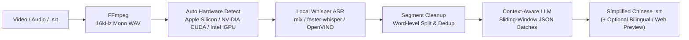

# SubGen · 中文字幕生成器

> Generate accurate, natural **Simplified Chinese (`.srt`)** subtitles for **Japanese** and **English** videos — automatically detecting your OS and GPU (**macOS Apple Silicon**, **Windows/Linux NVIDIA dGPU**, or **Windows/Linux Intel iGPU**) to pick the optimal local Whisper backend and model, with both a **CLI** and a **local Web UI**.

---

## Features

- **Automatic Cross-Platform Hardware & Model Selection**: Detects OS, GPU vendor/VRAM, and system RAM automatically to choose the best local Whisper runtime, precision, and model:
  - **macOS Apple Silicon (`arm64`)** → **`mlx-whisper`** (Metal GPU)
  - **Windows / Linux + NVIDIA dGPU** → **`faster-whisper`** (CUDA `float16` / `int8_float16` based on VRAM + Silero VAD, with automatic CPU fallback)
  - **Windows / Linux + Intel iGPU / Arc** → **`openvino-genai`** (OpenVINO `GPU` `int8` / `int4`, with automatic CPU fallback)
  - **Hybrid Windows Laptops (Intel iGPU + NVIDIA dGPU)** → Automatically prioritizes the NVIDIA dGPU while letting you override with `--asr openvino`
  - **CPU-only fallback** → **`faster-whisper`** (`int8`, `medium`)
- **Smart Cue Segmentation**: Uses Whisper word-level timestamps to split overly long cues cleanly at natural punctuation and speech pauses, while filtering empty punctuation and repetitive hallucination loops.
- **Context-Aware LLM Translation**: Translates cues in numbered JSON batches with a sliding read-only context window so pronouns, honorifics (日语敬语/主语省略), character names, and tone remain consistent across the entire video.
- **Cost-Efficient Default**: Defaults to OpenAI's **`gpt-6-luna`** (the cheapest model in the GPT-6 generation, with `reasoning_effort="none"` to avoid hidden reasoning token overhead), and supports **`gpt-5-nano`**, **Google Gemini**, **DeepSeek**, **OpenRouter**, and local **Ollama**.
- **CLI + Local Web UI**:
  - **CLI (`subgen`)**: Fast, scriptable command-line workflow with Rich progress bars and subtitle preview tables.
  - **Web UI (`subgen web`)**: Drag-and-drop upload or direct local file path mode (no copying multi-GB videos), real-time SSE progress, built-in HTML5 video player with live subtitle overlay, searchable inline Chinese editor, and one-click `.srt` downloads.
- **Direct `.srt` Translation**: Pass an existing Japanese or English `.srt` file to skip Whisper and translate straight to Simplified Chinese.
- **Zero System FFmpeg Hassle**: Automatically uses system `ffmpeg` if installed, or falls back to the bundled `imageio-ffmpeg` binary.

---

## Architecture



---

## Requirements

- **Python**: 3.11 or 3.12 (recommended for `mlx-whisper`, `faster-whisper`, and `openvino-genai` wheels)
- **Supported Platforms & Hardware**:
  - **macOS Apple Silicon (M1–M4)**: Metal GPU via `mlx-whisper`
  - **Windows 10/11 & Linux with NVIDIA dGPU**: CUDA via `faster-whisper` (CTranslate2)
  - **Windows 10/11 & Linux with Intel iGPU / Arc** (Iris Xe, UHD, Arc): Intel GPU via `openvino-genai`
  - **Any CPU-only machine**: `faster-whisper` (`int8`)
- **API Key**: An API key for OpenAI (or any OpenAI-compatible provider / Google Gemini)

---

## Installation

### 1. Clone and create a virtual environment

**macOS / Linux:**
```bash
git clone https://github.com/WeiLiu614/video-subtitle-translator.git
cd video-subtitle-translator
python3.12 -m venv .venv
source .venv/bin/activate
```

**Windows (PowerShell):**
```powershell
git clone https://github.com/WeiLiu614/video-subtitle-translator.git
cd video-subtitle-translator
py -3.12 -m venv .venv
.\.venv\Scripts\Activate.ps1
```

### 2. Install SubGen for your hardware

- **macOS Apple Silicon (MLX Metal GPU):**
  ```bash
  pip install -e ".[mlx,dev]"
  ```
- **Windows / Linux with NVIDIA dGPU (CUDA):**
  ```powershell
  pip install -e ".[nvidia,dev]"
  # Optional if CUDA 12 runtime DLLs (cublas64_12.dll / cudnn) are not already installed system-wide:
  pip install nvidia-cublas-cu12 nvidia-cudnn-cu12
  ```
- **Windows / Linux with Intel iGPU / Arc (OpenVINO GPU):**
  ```powershell
  pip install -e ".[intel,dev]"
  ```
- **Windows Hybrid Laptop (Intel iGPU + NVIDIA dGPU) or All Platform Backends:**
  ```powershell
  pip install -e ".[all,dev]"
  ```

### 3. Configure your API key

Copy `.env.example` to `.env` and fill in your key (`.env` is git-ignored):

```bash
cp .env.example .env
```

```env
# Default provider: OpenAI (gpt-6-luna)
OPENAI_API_KEY=your-openai-api-key

# Optional: switch OpenAI model (e.g. gpt-6-luna or gpt-5-nano)
# SUBGEN_OPENAI_MODEL=gpt-6-luna

# Optional: use OpenAI-compatible providers (DeepSeek, OpenRouter, Ollama, etc.)
# OPENAI_BASE_URL=https://api.deepseek.com/v1

# Optional: use Google Gemini instead
# GEMINI_API_KEY=your-gemini-api-key
# SUBGEN_TRANSLATOR=gemini
```

### 4. Verify your environment

```bash
subgen doctor
```

---

## Usage

### CLI

```bash
# Auto-detect Japanese or English and output <video>.zh.srt
subgen generate /path/to/video.mp4

# Japanese anime/drama with highest-accuracy Whisper + custom glossary
subgen generate episode01.mkv \
  --lang ja \
  --whisper-model large-v3 \
  --context "动画片；主角田中太郎译作太郎，保持自然轻松的口语风格"

# Save to a custom output path and also keep the original source .srt
subgen generate talk.mp4 -o output/talk.zh.srt --save-source

# Generate bilingual subtitles (Simplified Chinese + original text)
subgen generate interview.mp4 --bilingual

# Translate an existing .srt directly (skips Whisper)
subgen generate subtitles.ja.srt -o subtitles.zh.srt

# Override provider / model at runtime
subgen generate video.mp4 --translator openai --model gpt-6-luna
subgen generate video.mp4 --translator gemini --model gemini-4-hydrogen
subgen generate video.mp4 --translator gemini --model gemini-3.5-flash-lite
subgen generate video.mp4 --translator openai --base-url https://api.deepseek.com/v1 --model deepseek-flash
```

#### Key CLI Options (`subgen generate`)

| Option | Default | Description |
| :--- | :--- | :--- |
| `-o, --output PATH` | `<stem>.zh.srt` | Output `.srt` file path |
| `-l, --lang` | `auto` | Source language: `auto`, `ja`, or `en` |
| `--asr` | `auto` | Local Whisper backend: `auto`, `mlx`, `faster-whisper`, or `openvino` |
| `--whisper-model` | `auto` | `auto` (hardware-selected), model alias (`large-v3-turbo`, `large-v3`, `large-v3-turbo-int4`, `medium`, etc.), or Hugging Face repo |
| `-t, --translator` | `openai` | Translation provider: `openai` or `gemini` |
| `-m, --model` | `gpt-6-luna` / `gemini-4-hydrogen` | LLM model override |
| `--api-key` | from `.env` | API key override |
| `--base-url` | from `.env` | Custom OpenAI-compatible API base URL |
| `--batch-size` | `30` | Number of subtitle cues translated per LLM request (`1–100`) |
| `--context TEXT` | `""` | Optional video topic, tone, or proper-noun glossary |
| `--save-source` | `false` | Also write the transcribed source-language `.srt` |
| `--bilingual` | `false` | Write Chinese + original text together in the output `.srt` |

### Local Web UI

Launch the browser studio:

```bash
subgen web
```

Opens at `http://127.0.0.1:8000` (options: `--host`, `--port`, `--no-open`).

What you can do in the Web UI:
1. **Upload or Reference Local Files**: Drag and drop video/audio/`.srt` files, or switch to **Local File Path** mode for multi-GB videos so nothing has to be uploaded or duplicated.
2. **Watch Real-Time Progress**: Live progress bar and stage indicators (`Extract → Transcribe → Translate → Write SRT`) streamed via Server-Sent Events (SSE).
3. **Preview & Edit Inline**: Watch the video in the built-in HTML5 player with live WebVTT Chinese/bilingual subtitles, click any cue timestamp to seek, search cues, and edit Chinese translations inline with automatic sync.
4. **Download**: Export Simplified Chinese (`.zh.srt`), Bilingual (`.bilingual.srt`), or Original source `.srt` with one click.

---

## Automatic Hardware & Model Selection

When `--asr auto` and `--whisper-model auto` (the defaults) are used, SubGen inspects your OS, GPUs, VRAM, and RAM and automatically chooses:

| OS & Hardware | Auto Backend | Device & Precision | Auto Whisper Model |
| :--- | :--- | :--- | :--- |
| **macOS Apple Silicon (16 GB+ RAM)** | `mlx` | Metal GPU | `large-v3-turbo` (`mlx-community/whisper-large-v3-turbo`) |
| **macOS Apple Silicon (8 GB RAM)** | `mlx` | Metal GPU | `medium` (`mlx-community/whisper-medium-mlx`) |
| **Windows / Linux + NVIDIA dGPU (≥ 6 GB VRAM)** | `faster-whisper` | `cuda` (`float16`) | `large-v3-turbo` |
| **Windows / Linux + NVIDIA dGPU (4–6 GB VRAM)** | `faster-whisper` | `cuda` (`int8_float16`) | `large-v3-turbo` |
| **Windows / Linux + NVIDIA dGPU (< 4 GB VRAM)** | `faster-whisper` | `cuda` (`int8_float16`) | `medium` |
| **Windows / Linux + Intel iGPU / Arc (> 10 GB RAM)** | `openvino` | Intel `GPU` (`int8`) | `large-v3-turbo` (`OpenVINO/whisper-large-v3-turbo-int8-ov`) |
| **Windows / Linux + Intel iGPU (≤ 10 GB RAM)** | `openvino` | Intel `GPU` (`int4`) | `large-v3-turbo-int4` (`OpenVINO/whisper-large-v3-turbo-int4-ov`) |
| **CPU-only (Windows / Linux / Intel Mac)** | `faster-whisper` | `cpu` (`int8`) | `medium` |

*(Models download automatically from Hugging Face on first run and are cached locally. You can override the model at any time with `--whisper-model large-v3`, `medium`, `small`, etc.)*

### Cloud LLM Translation Models

| Provider | Model | Relative Cost (per 1M tokens) | Notes |
| :--- | :--- | :--- | :--- |
| **OpenAI** *(default)* | `gpt-6-luna` | Low (`$0.10` in / `$0.50` out) | Cheapest model in newest GPT-6 family; runs with `reasoning_effort="none"` |
| **OpenAI** | `gpt-6.2-sol` | Mid (`$2.00` in / `$10.00` out) | Higher-tier GPT-6.2 model for nuanced localization |
| **OpenAI** | `gpt-5-nano` | Ultra-Low (`$0.05` in / `$0.40` out) | Prior-gen lowest-cost option |
| **Google Gemini** *(default)* | `gemini-4-hydrogen` | Mid (`$1.50` in / `$7.50` out) | Newest fast Gemini 4 model; runs with `thinking_level="LOW"` |
| **Google Gemini** | `gemini-3.5-flash-lite` / `gemini-3.8-flash` | Low (`$0.30` / `$0.75` in) | Budget / high-throughput Gemini 3 alternatives |
| **DeepSeek (OpenAI-Compatible)** | `deepseek-flash` / `deepseek-v4-pro` | Low | Active DeepSeek-V4.1 models via `OPENAI_BASE_URL=https://api.deepseek.com/v1` |
| **Local LLM** | Ollama, vLLM, etc. | Free (local) | Set `OPENAI_BASE_URL=http://localhost:11434/v1` and `--model` |

---

## Environment Variables

| Variable | Default | Description |
| :--- | :--- | :--- |
| `OPENAI_API_KEY` | — | OpenAI or compatible provider API key |
| `OPENAI_BASE_URL` | — | Custom base URL (DeepSeek, OpenRouter, Ollama, etc.) |
| `GEMINI_API_KEY` | — | Google Gemini API key |
| `SUBGEN_TRANSLATOR` | `openai` | Default translation backend (`openai` or `gemini`) |
| `SUBGEN_OPENAI_MODEL` | `gpt-6-luna` | Default OpenAI model |
| `SUBGEN_GEMINI_MODEL` | `gemini-4-hydrogen` | Default Gemini model |
| `SUBGEN_ASR_BACKEND` | `auto` | Default local Whisper backend (`auto`, `mlx`, `faster-whisper`, `openvino`) |
| `SUBGEN_WHISPER_MODEL` | `auto` | Default Whisper model (`auto` = hardware-selected, or explicit model name) |

---

## Project Structure

```text
src/subgen/
├── audio.py         # FFmpeg discovery, duration probing, 16kHz mono WAV extraction
├── cli.py           # Click + Rich CLI (`generate`, `web`, `doctor`)
├── config.py        # Environment loading & MLX / OpenVINO / faster-whisper presets
├── hardware.py      # Cross-platform OS & GPU detection (Apple Silicon / NVIDIA / Intel)
├── models.py        # Pydantic data models for segments, config, and progress events
├── pipeline.py      # Shared end-to-end orchestration pipeline
├── srt.py           # SRT & WebVTT rendering, parsing, and file I/O
├── transcribe.py    # Local mlx-whisper, faster-whisper (CUDA/CPU), & OpenVINO GPU backends
├── translate.py     # Context-aware JSON batch translator (OpenAI / Gemini) with retries
└── web/
    ├── app.py       # FastAPI server, SSE progress stream, media & VTT/SRT endpoints
    └── static/      # Zero-build HTML/CSS/JS studio frontend
tests/               # Pytest suite covering hardware detect, SRT, ASR, LLM, pipeline & Web UI
```

---

## Development & Testing

```bash
source .venv/bin/activate
pytest -v
```

---

## Troubleshooting

- **External exFAT drive on macOS (`UnicodeDecodeError` in `pip` or `importlib.metadata`)**: macOS may create AppleDouble sidecar files (`._*.dist-info`) inside `.venv` on exFAT volumes. Clean them with:
  ```bash
  find .venv -name '._*' -delete
  ```
- **First Whisper run takes a moment**: The selected Whisper model weights are downloaded once from Hugging Face and cached locally for subsequent runs.
- **API key errors**: Run `subgen doctor` to verify `.env` is loaded and check whether `OPENAI_API_KEY` or `GEMINI_API_KEY` is detected.
