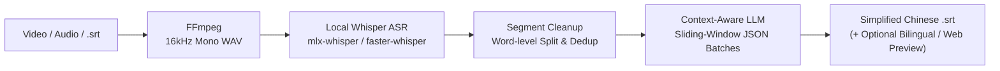

# SubGen · 中文字幕生成器

> Generate accurate, natural **Simplified Chinese (`.srt`)** subtitles for **Japanese** and **English** videos — powered by local Whisper on Apple Silicon and context-aware LLM translation, with both a **CLI** and a **local Web UI**.

---

## Features

- **Local-First Speech Recognition (Free & Private)**: Transcribes Japanese (`ja`) and English (`en`) audio locally using **`mlx-whisper`** on Apple Silicon GPU (Metal) or **`faster-whisper`** (CTranslate2 + Silero VAD).
- **Smart Cue Segmentation**: Uses Whisper word-level timestamps to split overly long cues cleanly at natural punctuation and speech pauses, while filtering empty punctuation and repetitive hallucination loops.
- **Context-Aware LLM Translation**: Translates cues in numbered JSON batches with a sliding read-only context window so pronouns, honorifics (日语敬语/主语省略), character names, and tone remain consistent across the entire video.
- **Cost-Efficient Default**: Defaults to OpenAI's **`gpt-6-luna`** (the cheapest model in the GPT-6 generation, with `reasoning_effort="none"` to avoid hidden reasoning token overhead), and supports **`gpt-5-nano`**, **Google Gemini**, **DeepSeek**, **OpenRouter**, and local **Ollama**.
- **CLI + Local Web UI**:
  - **CLI (`subgen`)**: Fast, scriptable command-line workflow with Rich progress bars and subtitle preview tables.
  - **Web UI (`subgen web`)**: Drag-and-drop upload or direct local file path mode (no copying multi-GB videos), real-time SSE progress, built-in HTML5 video player with live subtitle overlay, searchable inline Chinese editor, and one-click `.srt` downloads.
- **Direct `.srt` Translation**: Pass an existing Japanese or English `.srt` file to skip Whisper and translate straight to Simplified Chinese.
- **Zero System FFmpeg Hassle**: Automatically uses system `ffmpeg` if installed, or falls back to the bundled `imageio-ffmpeg` binary.

---

## Architecture



---

## Requirements

- **Python**: 3.11 or 3.12 (recommended for `mlx-whisper` / `faster-whisper` wheels)
- **Hardware**: Apple Silicon Mac (`arm64`) recommended for `mlx-whisper`; any macOS/Linux/Windows CPU or GPU works with `faster-whisper`
- **API Key**: An API key for OpenAI (or any OpenAI-compatible provider / Google Gemini)

---

## Installation

### 1. Clone and create a virtual environment

```bash
git clone https://github.com/WeiLiu614/video-subtitle-translator.git
cd video-subtitle-translator
python3.12 -m venv .venv
source .venv/bin/activate
```

### 2. Install SubGen

- **Apple Silicon Mac (recommended — MLX GPU acceleration):**
  ```bash
  pip install -e ".[mlx,dev]"
  ```
- **Cross-platform / CPU / NVIDIA (`faster-whisper`):**
  ```bash
  pip install -e ".[faster-whisper,dev]"
  ```
- **Both local Whisper backends:**
  ```bash
  pip install -e ".[all,dev]"
  ```

### 3. Configure your API key

Copy `.env.example` to `.env` and fill in your key (`.env` is git-ignored):

```bash
cp .env.example .env
```

```env
# Default provider: OpenAI (gpt-6-luna)
OPENAI_API_KEY=your-openai-api-key

# Optional: switch OpenAI model (e.g. gpt-6-luna or gpt-5-nano)
# SUBGEN_OPENAI_MODEL=gpt-6-luna

# Optional: use OpenAI-compatible providers (DeepSeek, OpenRouter, Ollama, etc.)
# OPENAI_BASE_URL=https://api.deepseek.com/v1

# Optional: use Google Gemini instead
# GEMINI_API_KEY=your-gemini-api-key
# SUBGEN_TRANSLATOR=gemini
```

### 4. Verify your environment

```bash
subgen doctor
```

---

## Usage

### CLI

```bash
# Auto-detect Japanese or English and output <video>.zh.srt
subgen generate /path/to/video.mp4

# Japanese anime/drama with highest-accuracy Whisper + custom glossary
subgen generate episode01.mkv \
  --lang ja \
  --whisper-model large-v3 \
  --context "动画片；主角田中太郎译作太郎，保持自然轻松的口语风格"

# Save to a custom output path and also keep the original source .srt
subgen generate talk.mp4 -o output/talk.zh.srt --save-source

# Generate bilingual subtitles (Simplified Chinese + original text)
subgen generate interview.mp4 --bilingual

# Translate an existing .srt directly (skips Whisper)
subgen generate subtitles.ja.srt -o subtitles.zh.srt

# Override provider / model at runtime
subgen generate video.mp4 --translator openai --model gpt-5-nano
subgen generate video.mp4 --translator gemini --model gemini-2.5-flash
subgen generate video.mp4 --translator openai --base-url https://api.deepseek.com/v1 --model deepseek-chat
```

#### Key CLI Options (`subgen generate`)

| Option | Default | Description |
| :--- | :--- | :--- |
| `-o, --output PATH` | `<stem>.zh.srt` | Output `.srt` file path |
| `-l, --lang` | `auto` | Source language: `auto`, `ja`, or `en` |
| `--asr` | `auto` | Local Whisper backend: `auto`, `mlx`, or `faster-whisper` |
| `--whisper-model` | `large-v3-turbo` | Whisper model alias or MLX Hugging Face repo ID |
| `-t, --translator` | `openai` | Translation provider: `openai` or `gemini` |
| `-m, --model` | `gpt-6-luna` / `gemini-2.5-flash` | LLM model override |
| `--api-key` | from `.env` | API key override |
| `--base-url` | from `.env` | Custom OpenAI-compatible API base URL |
| `--batch-size` | `30` | Number of subtitle cues translated per LLM request (`1–100`) |
| `--context TEXT` | `""` | Optional video topic, tone, or proper-noun glossary |
| `--save-source` | `false` | Also write the transcribed source-language `.srt` |
| `--bilingual` | `false` | Write Chinese + original text together in the output `.srt` |

### Local Web UI

Launch the browser studio:

```bash
subgen web
```

Opens at `http://127.0.0.1:8000` (options: `--host`, `--port`, `--no-open`).

What you can do in the Web UI:
1. **Upload or Reference Local Files**: Drag and drop video/audio/`.srt` files, or switch to **Local File Path** mode for multi-GB videos so nothing has to be uploaded or duplicated.
2. **Watch Real-Time Progress**: Live progress bar and stage indicators (`Extract → Transcribe → Translate → Write SRT`) streamed via Server-Sent Events (SSE).
3. **Preview & Edit Inline**: Watch the video in the built-in HTML5 player with live WebVTT Chinese/bilingual subtitles, click any cue timestamp to seek, search cues, and edit Chinese translations inline with automatic sync.
4. **Download**: Export Simplified Chinese (`.zh.srt`), Bilingual (`.bilingual.srt`), or Original source `.srt` with one click.

---

## Model Recommendations

### Local Whisper Models (Apple Silicon MLX)

| Model | Speed | JA / EN Accuracy | Best For |
| :--- | :--- | :--- | :--- |
| `large-v3-turbo` *(default)* | Very Fast | High | Everyday Japanese & English videos |
| `large-v3` | Moderate | Highest | Noisy audio, fast Japanese dialogue, accents |
| `medium` | Fast | Good | Lower RAM usage |
| `small` / `base` | Ultra Fast | Basic | Quick tests and clean English speech |

*(Models download automatically from Hugging Face on first run and are cached locally.)*

### Cloud LLM Translation Models

| Provider | Model | Relative Cost | Notes |
| :--- | :--- | :--- | :--- |
| **OpenAI** *(default)* | `gpt-6-luna` | Low (`$0.10` in / `$0.50` out per 1M) | Cheapest model in GPT-6 generation; runs with `reasoning_effort="none"` |
| **OpenAI** | `gpt-5-nano` | Ultra-Low (`$0.05` in / `$0.40` out per 1M) | Prior-gen lowest-cost option |
| **Google Gemini** | `gemini-2.5-flash` | Low | Strong multilingual subtitle quality |
| **OpenAI-Compatible** | `deepseek-chat`, Ollama, etc. | Varies / Free (local) | Set `OPENAI_BASE_URL` and `--model` |

---

## Environment Variables

| Variable | Default | Description |
| :--- | :--- | :--- |
| `OPENAI_API_KEY` | — | OpenAI or compatible provider API key |
| `OPENAI_BASE_URL` | — | Custom base URL (DeepSeek, OpenRouter, Ollama, etc.) |
| `GEMINI_API_KEY` | — | Google Gemini API key |
| `SUBGEN_TRANSLATOR` | `openai` | Default translation backend (`openai` or `gemini`) |
| `SUBGEN_OPENAI_MODEL` | `gpt-6-luna` | Default OpenAI model |
| `SUBGEN_GEMINI_MODEL` | `gemini-2.5-flash` | Default Gemini model |
| `SUBGEN_ASR_BACKEND` | `auto` | Default local Whisper backend (`auto`, `mlx`, `faster-whisper`) |
| `SUBGEN_WHISPER_MODEL` | `large-v3-turbo` | Default Whisper model |

---

## Project Structure

```text
src/subgen/
├── audio.py         # FFmpeg discovery, duration probing, 16kHz mono WAV extraction
├── cli.py           # Click + Rich CLI (`generate`, `web`, `doctor`)
├── config.py        # Environment loading & MLX Whisper model presets
├── models.py        # Pydantic data models for segments, config, and progress events
├── pipeline.py      # Shared end-to-end orchestration pipeline
├── srt.py           # SRT & WebVTT rendering, parsing, and file I/O
├── transcribe.py    # Local mlx-whisper & faster-whisper backends + cue post-processing
├── translate.py     # Context-aware JSON batch translator (OpenAI / Gemini) with retries
└── web/
    ├── app.py       # FastAPI server, SSE progress stream, media & VTT/SRT endpoints
    └── static/      # Zero-build HTML/CSS/JS studio frontend
tests/               # Pytest suite covering SRT, ASR cleanup, LLM batching, pipeline & Web UI
```

---

## Development & Testing

```bash
source .venv/bin/activate
pytest -v
```

---

## Troubleshooting

- **External exFAT drive on macOS (`UnicodeDecodeError` in `pip` or `importlib.metadata`)**: macOS may create AppleDouble sidecar files (`._*.dist-info`) inside `.venv` on exFAT volumes. Clean them with:
  ```bash
  find .venv -name '._*' -delete
  ```
- **First Whisper run takes a moment**: The selected Whisper model weights are downloaded once from Hugging Face and cached locally for subsequent runs.
- **API key errors**: Run `subgen doctor` to verify `.env` is loaded and check whether `OPENAI_API_KEY` or `GEMINI_API_KEY` is detected.
